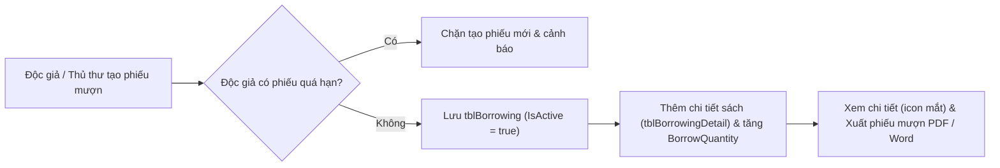
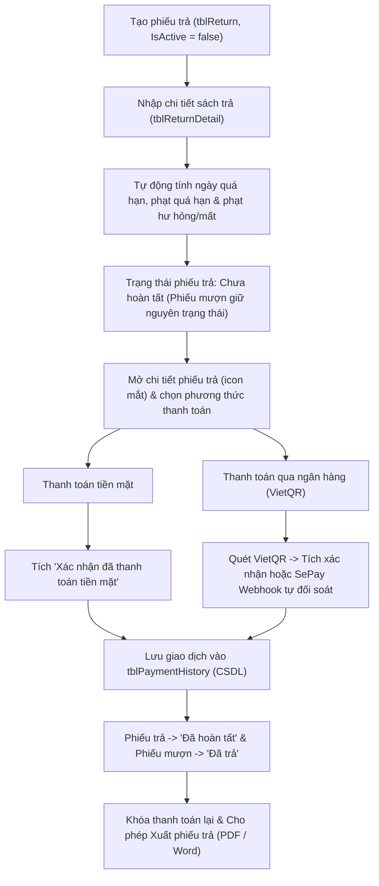

# LibraryHub — Hệ thống Quản lý Thư viện

**LibraryHub** là hệ thống quản lý thư viện số xây dựng bằng **ASP.NET Core MVC**, **Entity Framework Core**, **SQL Server**, tích hợp xuất phiếu mượn/trả định dạng **PDF & Word (.docx)**, thanh toán **VietQR** (kèm đối soát và lưu lịch sử giao dịch), thống kê trực quan và **Chatbot AI** hỗ trợ tra cứu.

---

## 1. Công nghệ sử dụng

| Thành phần | Công nghệ |
| --- | --- |
| **Backend** | ASP.NET Core MVC (.NET), Entity Framework Core, Cookie Authentication, Session |
| **Cơ sở dữ liệu** | Microsoft SQL Server |
| **Giao diện (Frontend)** | Razor Views, Bootstrap 5, Bootstrap Icons, NiceAdmin, Simple-DataTables (Việt hóa), Chart.js / ECharts |
| **Xuất tài liệu** | **iText7** (PDF), **DocumentFormat.OpenXml** (Word `.docx`) |
| **Thanh toán** | **VietQR** (`img.vietqr.io` + EMVCo payload), hỗ trợ **SePay Webhook / API** và đối soát thủ công |
| **Chatbot AI** | Python FastAPI (`Chatbot/`) kết nối Gemini API |

---

## 2. Cấu trúc dự án

```text
LibraryHub/
├── Areas/
│   └── Admin/                      # Khu vực quản trị (Admin & Thủ thư)
│       ├── Components/             # Menu quản trị động (AdminMenuComponent)
│       ├── Controllers/            # 19 Controllers quản trị:
│       │   ├── BookController.cs           # Quản lý sách & Import Excel
│       │   ├── AuthorController.cs         # Quản lý tác giả
│       │   ├── CategoryController.cs       # Quản lý thể loại
│       │   ├── PublisherController.cs      # Quản lý nhà xuất bản
│       │   ├── PatronController.cs         # Quản lý độc giả
│       │   ├── LibrarianController.cs      # Quản lý thủ thư
│       │   ├── BorrowingController.cs      # Quản lý phiếu mượn, chi tiết & xuất PDF/Word
│       │   ├── BorrowingDetailController.cs# Quản lý chi tiết sách mượn
│       │   ├── ReturnController.cs         # Quản lý phiếu trả, thanh toán VietQR/Tiền mặt, đối soát & xuất PDF/Word
│       │   ├── ReturnDetailController.cs   # Quản lý chi tiết sách trả & tính phạt
│       │   ├── StatisticsController.cs     # Thống kê, báo cáo biểu đồ
│       │   ├── UserController.cs           # Quản lý tài khoản người dùng
│       │   ├── RolesController.cs          # Quản lý vai trò
│       │   ├── UserRoleController.cs       # Phân quyền người dùng
│       │   ├── PostController.cs           # Quản lý bài viết / tin tức
│       │   ├── LibraryReviewController.cs  # Quản lý đánh giá thư viện
│       │   ├── MenuController.cs           # Quản lý menu giao diện
│       │   ├── FileManagerController.cs    # Trình quản lý tệp (elFinder)
│       │   └── HomeController.cs           # Trang tổng quan Dashboard
│       ├── Services/
│       │   └── ReturnService.cs            # Tính tổng phạt và đồng bộ trạng thái phiếu trả / phiếu mượn
│       └── Views/                          # Giao diện Razor cho từng module quản trị
├── Controllers/                    # Khu vực cổng thông tin độc giả (Public/Patron)
│   ├── HomeController.cs           # Trang chủ thư viện
│   ├── BooksController.cs          # Tra cứu, lọc và xem chi tiết sách
│   ├── BorrowingCartController.cs  # Giỏ mượn sách trực tuyến (Session)
│   ├── ProfileController.cs        # Hồ sơ cá nhân & lịch sử mượn của độc giả
│   ├── LoginController.cs          # Đăng nhập, đăng xuất, giữ phiên (KeepAlive)
│   ├── RegisterController.cs       # Đăng ký tài khoản độc giả
│   ├── ChatController.cs           # Giao tiếp với dịch vụ Chatbot AI
│   ├── PaymentWebhookController.cs # Webhook SePay (/api/payments/sepay-webhook) & API kiểm tra trạng thái
│   ├── PostController.cs           # Xem tin tức, bài viết
│   ├── LibraryReviewController.cs  # Gửi & xem đánh giá thư viện
│   ├── IntroductionController.cs   # Giới thiệu thư viện
│   └── ContactController.cs        # Liên hệ
├── Models/                         # Các Entity ánh xạ SQL Server & ViewModels
│   ├── DataContext.cs              # DbContext trung tâm & cấu hình quan hệ bảng
│   ├── tblBook.cs, tblCategory.cs, tblAuthor.cs, tblPulisher.cs
│   ├── tblPatron.cs, tblLibrarian.cs, tblUsers.cs, tblRoles.cs, tblUsersRoles.cs
│   ├── tblBorrowing.cs, tblBorrowingDetail.cs
│   ├── tblReturn.cs, tblReturnDetail.cs
│   ├── tblPaymentSetting.cs        # Cấu hình mức phạt/ngày & tài khoản ngân hàng VietQR
│   ├── tblPaymentHistory.cs        # Lịch sử thanh toán (Tiền mặt / VietQR, mã giao dịch, đối soát)
│   ├── tblUnmatchedBankTransaction.cs # Giao dịch ngân hàng chưa đối soát được
│   └── VietQrPaymentOptions.cs     # Cấu hình VietQR / SePay
├── Services/                       # Nghiệp vụ dùng chung
│   ├── FeePaymentService.cs        # Tính số ngày quá hạn, tiền phạt, sinh URL & EMVCo payload VietQR
│   ├── PaymentReconciler.cs        # Đối soát giao dịch SePay (idempotent, chống trùng tiền tố RT)
│   ├── LibraryStatisticsService.cs # Tổng hợp số liệu thống kê
│   └── Chat/                       # Tích hợp Gemini & Python Chatbot client
├── Chatbot/                        # Dịch vụ Chatbot AI (Python FastAPI)
├── Components/                     # ViewComponents dùng chung
├── Views/                          # Giao diện phía độc giả & Shared Layout
├── wwwroot/                        # Tài nguyên tĩnh (CSS, JS, font Arial, ảnh, vendor)
├── .gitignore                      # Chặn tệp build và toàn bộ tệp chứa API Key / bí mật
├── appsettings.Example.json        # Mẫu cấu hình an toàn (không chứa secret)
└── Program.cs                      # Khởi tạo ứng dụng, DI, Authentication, Session & Routing
```

---

## 3. Phân quyền người dùng

1. **Quản trị viên (`Admin`)**: Toàn quyền quản trị hệ thống (tài khoản, vai trò, thủ thư, độc giả, sách, phiếu mượn/trả, thống kê, bài viết, cấu hình).
2. **Thủ thư (`Librarian`)**: Quản lý nghiệp vụ thư viện (sách, độc giả, phiếu mượn, phiếu trả, thu phí/phạt, xuất phiếu PDF/Word, xem thống kê).
3. **Độc giả (`Patron`)**: Tra cứu sách, thêm sách vào giỏ mượn, xem lịch sử mượn/trả cá nhân, đổi mật khẩu, gửi đánh giá và hỏi đáp với Chatbot AI.

---

## 4. Luồng nghiệp vụ chính

### 4.1. Luồng mượn sách



- Kiểm tra ràng buộc hạn trả phải lớn hơn hoặc bằng ngày mượn.
- Tự động tính tổng phí mượn (`TotalBorrowingFee`) từ các sách đang mượn.
- Tìm kiếm phiếu mượn theo **tên hoặc email độc giả** (chỉ đối chiếu phần trước `@` nếu từ khóa không chứa `@`, tránh khớp nhầm `@gmail.com`).

---

### 4.2. Luồng trả sách, thanh toán & đồng bộ trạng thái



- **Chống thanh toán trùng lặp**: Khi phiếu trả đã có giao dịch `Đã thanh toán` trong `tblPaymentHistory`, hệ thống khóa nút thanh toán (cả ở danh sách và trang chi tiết) và chặn ở phía máy chủ.
- **Đối soát sai lệch**: Trong mục **Lịch sử thanh toán** của Chi tiết phiếu trả có công cụ **Đối soát giao dịch sai thông tin** để nhập mã giao dịch và số tiền ngân hàng thực nhận nhằm kiểm tra trùng khớp và ghi nhận chênh lệch.
- **Đồng bộ trạng thái**: Chỉ khi phiếu trả được xác nhận thanh toán thành công (**Đã hoàn tất**) thì phiếu mượn gốc mới chuyển sang **Đã trả**.

---

### 4.3. Luồng Chatbot AI

1. Người dùng gửi câu hỏi qua widget chat (`_ChatWidget.cshtml` → `ChatController`).
2. `LibraryHub` chuyển tiếp câu hỏi tới dịch vụ Python FastAPI (`Chatbot/`) kèm ngữ cảnh dữ liệu thư viện (sách, thể loại, quy định mượn trả) hoặc gọi Gemini API.
3. Trả về câu trả lời trực tiếp trên giao diện.

---

## 5. Hướng dẫn cài đặt & cấu hình bí mật (API Keys)

> **Lưu ý bảo mật**: Các tệp chứa khóa API (`.env`, `appsettings.Development.json`, `appsettings.Local.json`, `secrets.json`, `Chatbot/.env`) đã được chặn trong `.gitignore`. **Tuyệt đối không commit API Key vào Git.**

### Bước 1: Chuẩn bị cấu hình
1. Sao chép `appsettings.Example.json` thành `appsettings.Development.json` (hoặc cấu hình trực tiếp bằng `.NET User Secrets`).
2. Cập nhật chuỗi kết nối `ConnectionStrings:DefaultConnection` trỏ tới SQL Server của bạn.

### Bước 2: Thiết lập khóa API bằng User Secrets (Khuyên dùng)
Chạy các lệnh sau trong thư mục `LibraryHub`:

```powershell
dotnet user-secrets init
dotnet user-secrets set "Gemini:ApiKey" "<GEMINI_API_KEY>"
dotnet user-secrets set "VietQrPayment:AccountNumber" "<SO_TAI_KHOAN>"
dotnet user-secrets set "VietQrPayment:SePayApiToken" "<SEPAY_API_TOKEN>"
dotnet user-secrets set "VietQrPayment:WebhookApiKey" "<WEBHOOK_API_KEY>"
```

### Bước 3: Chạy ứng dụng
```powershell
dotnet restore
dotnet run
```
Truy cập:
- Trang độc giả: `http://localhost:5091`
- Trang quản trị: `http://localhost:5091/Admin/Home/Index`

*(Tùy chọn)* Chạy dịch vụ Chatbot Python:
```powershell
cd Chatbot
pip install -r requirements.txt
# Tạo file Chatbot/.env từ Chatbot/.env.example và điền API Key
uvicorn main:app --host 127.0.0.1 --port 8010
```
